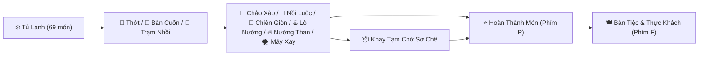

# 🍳🥢 YumCraft Kitchen — Không Gian Nấu Ăn Sáng Tạo & Trợ Năng Bàn Phím Toàn Diện

[](./LICENSE)
[](#-thiết-kế-trợ-năng-toàn-diện-accessibility--nvda-first)
[](#-bảng-phím-tắt-toàn-năng-keyboard-shortcuts)
[](#-công-nghệ--kiến-trúc-mã-nguồn)
[](#-hướng-dẫn-cài-đặt--trải-nghiệm)

> **YumCraft Kitchen** là trò chơi mô phỏng nấu ăn tự do thế hệ mới, lấy cảm hứng từ triết lý sáng tạo mở của **Toca Kitchen**, kết hợp cùng bộ máy **hóa học vị giác cảm quan động** và kiến trúc **trợ năng chuẩn quốc tế (WCAG 2.2 AA/AAA)** dành riêng cho người khiếm thị sử dụng trình đọc màn hình **NVDA** cùng bàn phím máy tính.

---

## 🌟 Mục Lục
- [1. Triết Lý Thiết Kế Cốt Lõi (Sandbox Philosophy)](#-1-triết-lý-thiết-kế-cốt-lõi-sandbox-philosophy)
- [2. Các Tính Năng Nổi Bật](#-2-các-tính-năng-nổi-bật)
  - [2.1. Bộ Máy Hóa Học Vị Giác Cảm Quan (Dynamic Sensory Chemistry)](#21-bộ-máy-hóa-học-vị-giác-cảm-quan-dynamic-sensory-chemistry)
  - [2.2. Kho 69 Nguyên Liệu & 18 Gia Vị](#22-kho-69-nguyên-liệu--18-gia-vị)
  - [2.3. Hệ Thống 9 Trạm Chế Biến Toàn Năng](#23-hệ-thống-9-trạm-chế-biến-toàn-năng)
  - [2.4. 4 Thực Khách Cá Tính & Nhận Xét 4 Tầng Sống Động](#24-4-thực-khách-cá-tính--nhận-xét-4-tầng-sống-động)
  - [2.5. Bộ Tổng Hợp Âm Thanh Foley (Web Audio API Synthesizer)](#25-bộ-tổng-hợp-âm-thanh-foley-web-audio-api-synthesizer)
- [3. Thiết Kế Trợ Năng Toàn Diện (Accessibility & NVDA First)](#-3-thiết-kế-trợ-năng-toàn-diện-accessibility--nvda-first)
- [4. Bảng Phím Tắt Toàn Năng (Keyboard Shortcuts)](#-4-bảng-phím-tắt-toàn-năng-keyboard-shortcuts)
- [5. Công Nghệ & Kiến Trúc Mã Nguồn](#-5-công-nghệ--kiến-trúc-mã-nguồn)
- [6. Hướng Dẫn Cài Đặt & Trải Nghiệm](#-6-hướng-dẫn-cài-đặt--trải-nghiệm)
- [7. Tác Giả & Giấy Phép](#-7-tác-giả--giấy-phép)

---

## 💡 1. Triết Lý Thiết Kế Cốt Lõi (Sandbox Philosophy)

YumCraft Kitchen được xây dựng dựa trên 4 trụ cột cốt lõi:

1. **Hoàn Toàn Không Có Công Thức Cố Định (Zero Hardcoded Recipes)**:
   - Người chơi là một bếp trưởng sáng tạo tuyệt đối, không bị trói buộc bởi công thức sách giáo khoa cứng nhắc.
   - Bạn có thể cuộn bất cứ thứ gì trong thịt bò lát, nhồi phô mai và tôm vào bánh mì đem nướng than hoa, hoặc kết hợp sô-cô-la cùng khoai tây chiên giòn rụm!
2. **Hóa Học Vị Giác Cảm Quan Động (Dynamic Sensory Chemistry)**:
   - Đánh giá món ăn dựa trên các định luật vật lý và hóa học vị giác thực tế (Umami, Mặn, Ngọt, Chua, Cay, Béo, Đắng/Khét, Thơm, Giòn).
   - Hệ thống phản ánh trung thực nguyên liệu và gia vị bạn vừa trực tiếp chế biến, tuyệt đối không gán nhãn hương vị tĩnh.
3. **Nhận Xét Thực Khách Sinh Động & Chân Thực (Living Character Critique)**:
   - Khi thưởng thức, nhân vật sẽ miêu tả chi tiết cảm giác vị giác, kết cấu món ăn (nướng, luộc, chiên giòn, cuộn, nhồi, xay mịn...) và nhắc tên chính xác từng loại gia vị bạn đã nêm nếm.
4. **Trợ Năng Bình Đẳng (WCAG 2.2 AA/AAA & NVDA-First)**:
   - Mọi tương tác, âm thanh, diễn biến nấu nướng và cảm giác vị giác đều được thiết kế tỉ mỉ để người chơi khiếm thị trải nghiệm trọn vẹn 100% qua bàn phím và trình đọc màn hình.

---

## 🚀 2. Các Tính Năng Nổi Bật

### 2.1. Bộ Máy Hóa Học Vị Giác Cảm Quan (Dynamic Sensory Chemistry)
Mỗi nguyên liệu và gia vị trong YumCraft Kitchen đều chứa các chỉ số hóa học vị giác riêng. Khi kết hợp, hệ thống sẽ kích hoạt các **phản ứng hòa vị tự nhiên (Flavor Synergies)**:
- 🍋🍬 **Chua + Ngọt Thanh Mát**: Cắt độ gắt tự nhiên, tăng độ thơm và kích thích tuyến nước bọt.
- 🧂🥩 **Muối / Mắm Tôn Vị Umami**: Muối biển và nước mắm kích hoạt vị ngọt sâu của đạm thịt, hải sản và nấm.
- 🥒🍋 **Vị Chua & Rau Thơm Cắt Độ Ngấy Béo**: Axit từ chanh, giấm và độ tươi giòn của dưa leo giúp cân bằng các món nhiều dầu mỡ.
- 🧈🌶️ **Độ Béo Làm Dịu Vị Cay**: Lớp béo ngậy từ bơ, sữa, phô mai làm dịu vị cay xè của ớt hiểm và tiêu đen.
- 🍫🥛 / 🍯🧈 **Hòa Vị Béo Ngọt Thơm Ngào Ngạt**: Tự động nhận diện ngữ cảnh:
  - Nếu có đồ ngọt (`chocolate`, `milk`, `oreo`): Kích hoạt cảm giác tráng miệng béo ngọt ngào ngạt.
  - Nếu là món thịt/mặn có bơ/mật ong: Kích hoạt hiệu ứng sốt caramel hóa quyến rũ.
- 🧀🥩 **Phô Mai Tan Chảy & Đạm Béo**: Phô mai kéo sợi ngậy thơm kết hợp cùng vị Umami đậm đà.
- 🔥🧄 **Gia Vị Ướp Thấm Sâu Khi Nấu**: Gia vị được nêm trước khi tác động nhiệt sẽ hòa quyện sâu vào từng thớ thịt.
- ⚠️ **Hệ Thống Cảnh Báo Nguy Cơ**: Cảnh báo tức thì nếu món ăn còn **thịt sống tanh**, **cháy khét đen**, **mặn chát** hoặc **cay bốc khói**.

### 2.2. Kho 69 Nguyên Liệu & 18 Gia Vị
Hệ thống nguyên liệu được phân loại trực quan trong Tủ Lạnh:
- 🍜 **Mì & Bột Làm Bánh**: Mì trứng tươi, Mì Ý Spaghetti, Mì Udon sợi to, Mì gói tôm chua cay giòn rụm, Bột mì đa dụng, Bột gạo tẻ thơm mịn, Bột chiên giòn Tempura.
- 🥖 **Vỏ Bánh & Đồ Cuốn**: Bánh tráng gạo mỏng, Lá rong biển Nori, Lá lốt tươi xanh, Bánh phở cuốn mềm, Vỏ bánh Burrito, Ổ Bánh Mì Việt Nam giòn, Vỏ Taco ngô giòn, Bánh mì kẹp Burger.
- ☕🍫 **Cà Phê, Đường & Đồ Ngọt**:
  - **4 Loại Đường Mật Tự Nhiên**: Đường cát trắng tinh luyện (làm kẹo hồ lô caramel giòn), Đường phèn kết tinh thanh mát (chưng yến, hầm lê, chè sen), Đường nâu mật mía tự nhiên (nấu sốt trân châu đường đen, bánh gừng), Đường thốt nốt thơm bùi An Giang (làm bánh bò, chè thốt nốt).
  - **4 Loại Cà Phê Thượng Hạng**: Cà phê phin truyền thống nguyên chất (pha cà phê sữa đá, bạc xỉu, làm tiramisu), Bột cà phê rang xay thơm lừng (nhào cốt bánh nướng cà phê, áo kẹo), Cốt Cà phê Espresso đậm đặc (làm cà phê đá xay mát lạnh, Affogato), Cà phê hòa tan thơm béo (tiện lợi hòa tan sữa kem).
  - **Sữa, Bánh & Đồ Ngọt Khác**: Sô-cô-la đen đắng, Sữa tươi tiệt trùng, Sữa đặc có đường, Bánh quy Oreo kem vani, Kẹo dẻo Marshmallow, Mạch nha dẻo quánh, Đá viên tuyết mát lạnh.
- 🥩 **Thịt, Xúc Xích & Pate**: Thịt bò thăn tươi, Thịt ba chỉ heo mỡ màng, Ức gà tươi phi lê, Xúc xích xông khói, Pate gan heo béo bùi.
- 🦐 **Hải Sản & Trứng**: Tôm sú tươi sống, Mực ống tươi giòn, Trứng gà tươi lòng đỏ vàng óng, Cá hồi Nauy tươi béo ngậy.
- 🥬 **Rau Củ & Trái Cây**: Xà lách giòn mát, Dưa leo tươi mát, Cà chua mọng nước, Ớt chuông Đà Lạt, Nấm hương tươi, Chuối chín ngọt, Dâu tây đỏ mọng.
- 🍚 **Tinh Bột & Phô Mai**: Cơm trắng dẻo, Bún tươi sợi trắng, Phô mai Cheddar lát, Khoai tây Đà Lạt.
- 🧂 **18 Loại Gia Vị Phong Phú**: Muối biển, Tiêu đen, Chanh tươi, Đường mía, Ớt hiểm cay, Nước mắm nhĩ, Nước tương đậu nành, Tương ớt cay ngọt, Mật ong rừng, Tỏi băm phi thơm, Gừng tươi sợi, Sả băm nồng, Sốt Mayonnaise, Bơ lạt Pháp, Ngũ vị hương, Dầu hào đậm đặc, Giấm gạo lên men, Phô mai bột.

### 2.3. Hệ Thống Bàn Chế Biến 3 Khu Vực & 9 Trạm Nấu Toàn Năng
Tại **Tab 2 (Bàn Chế Biến)**, không gian bếp được tái cấu trúc thành **3 Khu Vực Ngữ Nghĩa Độc Lập** với các thẻ Heading H3 chuẩn trợ năng quốc tế WCAG AA/AAA:
- **Khu 1 (`1. Chọn Dụng Cụ Nấu`)**: Toolbar gồm 9 nút chọn công cụ bếp trực quan.
- **Khu 2 (`2. Thao Tác Với [Tên Dụng Cụ]`)**: Tiêu đề tự động mang tên và emoji của công cụ đang chọn (ví dụ: *2. Thao Tác Với 🍳 Chảo Chiên Xào*, *2. Thao Tác Với 🌪️ Máy Xay Sinh Tố*...). Dưới heading này là các nút chế biến chính (áp chảo, đun sôi, bật lò, cuộn tròn, băm nhỏ...) và bộ chọn vỏ cuốn/nhồi.
- **Khu 3 (`3. Nguyên Liệu Đang Có Trong Bếp`)**: Danh sách thực phẩm đang nấu trong dụng cụ, nhiệt độ, trạng thái chín và cặp nút thao tác nhanh *Cất ra Khay Tạm (T)* cùng *Dọn sạch bếp*.
> **💡 Trợ năng NVDA**: Người chơi chỉ cần nhấn phím **`H`** hoặc phím số **`3`** để nhảy tức thì qua 3 khu vực; sau khi chọn công cụ ở Khu 1, ấn `H` một lần rồi ấn `Tab` là chạm ngay vào các nút chế biến!


1. 🔪 **Thớt & Dao Sắc**: Sơ chế nguyên liệu bằng 3 kỹ thuật cắt: thái lát mỏng (`slice`), thái hạt lựu (`dice`), băm nhuyễn (`mince`).
2. 🌯 **Bàn Cuốn Đa Năng (`rolling_mat`)**: Cho phép chọn **bất kỳ nguyên liệu nào làm vỏ cuộn** (bánh tráng, rong biển, lá lốt, bánh phở, lát thịt bò...) để cuộn tròn mọi loại nhân bên trong.
3. 🥖 **Trạm Kẹp & Nhồi Nhân (`stuffing_station`)**: Chọn một nguyên liệu làm vỏ nhồi (bánh mì, xúc xích, ớt chuông, mực, oreo...), xẻ ruột và nhồi đẫm các loại nhân.
4. 🍳 **Chảo Chiên Xào (`frying_pan`)**: Áp chảo thịt bò, chiên xúc xích, xào chín thơm dậy mùi phản ứng Maillard.
5. 🍲 **Nồi Luộc & Hầm (`boiling_pot`)**: Luộc tôm thịt mềm mọng nước hoặc nấu ca-cao sữa nóng ngọt ngào.
6. 🍟 **Chảo Chiên Giòn (`deep_fryer`)**: Chiên ngập dầu giòn rụm chả giò, khoai tây, bột tempura vàng óng.
7. ♨️ **Lò Nướng Đa Năng (`oven`)**: Nướng đối lưu vàng ruộm bánh mì, làm tan chảy phô mai và kẹo dẻo.
8. 🔥 **Vỉ Nướng Than Hoa (`charcoal_grill`)**: Nướng thịt xiên, bò lá lốt trên than hồng dậy mùi khói BBQ thơm nức mũi.
9. 🌪️ **Máy Xay Sinh Tố (`blender`)**: Xay nhuyễn trái cây, sữa, oreo thành sinh tố đá tuyết hoặc pha chế nước sốt sánh mịn.

### 2.4. 4 Thực Khách Cá Tính & Nhận Xét 4 Tầng Sống Động
Mỗi thực khách có khẩu vị, sở thích và giới hạn chịu cay riêng biệt:
- 🐻‍❄️ **Bếp Trưởng Gấu Bự**: Đam mê vị đậm đà, thịt bò, bánh mì nhồi đẫm nhân, món nướng than hoa và đồ ngọt đậm vị ca-cao/sữa.
- 🐱 **Cô Bé Mèo Miu**: Tín đồ gỏi cuốn, kimbap rong biển, hải sản, sinh tố mát lạnh và vị chua ngọt thanh dịu (chịu cay thấp).
- 🐲 **Anh Chàng Rồng Lửa**: Vua ăn cay và chiên nướng than hồng, mê ớt hiểm, tiêu đen và món chiên giòn rụm (chịu cay tối đa 10/10).
- 🦉 **Giáo Sư Cú Thông Thái**: Nhà phê bình ẩm thực khắt khe sự cân bằng âm dương ngũ hành, chuộng vị thanh tao và độ hòa quyện tinh tế.

**Bộ máy đánh giá cảm quan 4 tầng (`generateSensoryTastingReview`)**:
1. *Cấu trúc & Kỹ thuật chế biến*: Phân tích tỉ mỉ lớp vỏ ngoài (áp chảo, nướng than, chiên giòn...) và lớp nhân cuộn/nhồi bên trong.
2. *Vị giác hóa học chuyển ngữ*: Chuyển đổi con số thành câu văn miêu tả sống động (vị ngọt nước thịt, vị mặn vừa vặn, vị béo ngậy tan chảy, the cay ấm nồng...).
3. *Gia vị thực tế*: Nhắc tên chính xác từng loại gia vị đã được nêm nếm.
4. *Biểu cảm thực khách*: Khen ngợi 5 sao, trầm trồ, hoặc phản ứng hài hước nếu món bị nấu sống tanh, cháy khét đen hay nêm mặn chát.

### 2.5. Hệ Thống Âm Thanh Ngoài Chân Thực (Foley Audio), Cơ Chế Play Wait & Động Cơ Thưởng Thức Đa Tầng
Bên cạnh các hiệu ứng sóng tổng hợp Web Audio API (mở cửa tủ lạnh, cuộn, nhồi, rắc gia vị, hợp âm 5 sao), trò chơi trang bị **hệ thống âm thanh ngoài Foley chân thực đặt tại thư mục `sounds/` với cơ chế Play Wait đỉnh cao**:
- **Âm thanh dụng cụ bếp sống động (Play Wait)**:
  - 🔪 `food_cut.ogg`: Tiếng dao sắc bén thái lát, xắt hạt lựu, băm nhuyễn nguyên liệu trên thớt gỗ (phát tức thì).
  - 🍳 `frying_pan.ogg`: Tiếng xào nấu, áp chảo xèo xèo dậy mùi thơm Maillard (Play Wait).
  - 🍟 `deep_frying_pan.ogg`: Tiếng dầu sôi reo giòn tan ngập chảo (Play Wait).
  - 🍲 `pot_of_boiling_water.ogg`: Tiếng nước sôi ùng ục hầm nhừ ngọt nước trong nồi hầm (Play Wait).
  - ♨️ `oven.ogg`: Tiếng lò nướng đối lưu nhiệt ran và tiếng chuông báo chín ting vàng (Play Wait).
  - 🔥 `grill rack.ogg`: Tiếng quạt than hồng và mỡ nướng xèo xèo trên vỉ than BBQ (Play Wait).
  - 🌪️ `blender.ogg`: Tiếng động cơ máy xay sinh tố quay tít nghiền nhuyễn sánh mịn (Play Wait).
- **Động cơ âm thanh thưởng thức đa tầng (Sequential Multi-Course Tasting Engine)**:
  - Khi đút cho thực khách ăn (Phím `F`), hệ thống tự động phân loại kết cấu từng món trên dĩa (`crispy`, `soft`, `liquid`, `drink`) và lập Playlist thưởng thức thông minh:
    - 🥢 `eat_crispy_food.ogg`: Tiếng cắn giòn rụm (món chiên ngập dầu, nướng chín giòn, mì gói sống, ổi, cóc...).
    - 🥩 `eat_soft_food.ogg`: Tiếng nhai mềm mọng nước (bò bít tết áp chảo, đậu hũ, phô mai tan chảy, bánh tráng cuộn dẻo...).
    - 🥣 `eat_liquid_food.ogg`: Tiếng húp súp nóng hổi sùm sụp (canh hầm, mì nước chan nước dùng...).
    - 🥤 `drink.ogg` & `drink_with_ice.ogg`: Tiếng uống ừng ực sảng khoái (sinh tố trái cây, sữa đá xay lách cách tiếng đá tuyết).
  - **Khử trùng lặp âm thanh & sắp xếp logic**: Đĩa có nhiều món giòn được gom gọn, thực khách thưởng thức món ăn rắn trước rồi uống ngụm nước mát lành sau, kèm hiệu ứng khóa nút `aria-busy="true"` chuẩn trợ năng trước khi NVDA công bố lời nhận xét!

---

## ♿ 3. Thiết Kế Trợ Năng Toàn Diện (Accessibility & NVDA First)

YumCraft Kitchen được thiết kế theo tiêu chuẩn quốc tế **W3C WAI-ARIA 1.2** và **WCAG 2.2 Level AA/AAA**, được tối ưu hóa đặc biệt cho người dùng trình đọc màn hình **NVDA**:

- **Bố Cục 5 Tab Chuẩn Mực (`role="tablist"` / `role="tab"` / `role="tabpanel"`)**:
  - Tab 1: `Tủ Lạnh & Kho Đồ`
  - Tab 2: `Bàn Chế Biến`
  - Tab 3: `Khay Tạm`
  - Tab 4: `Gia Vị`
  - Tab 5: `Bàn Tiệc & Thưởng Thức`
  - Hỗ trợ đầy đủ phím mũi tên `ArrowLeft` / `ArrowRight` / `ArrowUp` / `ArrowDown`, `Home`, `End` và chuyển đổi tab tức thì bằng `Alt + 1..5`.
- **Cấu Trúc Heading Tinh Gọn (Khắc Phục Lỗi Bấm Phím `H` Bị Loạn)**:
  - Mỗi tabpanel chỉ chứa **duy nhất một thẻ semantic `<h2>` đại diện cho khu vực đó**. Người dùng NVDA có thể tự tin bấm phím `H` để duyệt xuyên suốt bố cục trang mà không bị nhảy qua hàng chục tiêu đề vụn vặt.
- **Hệ Thống ARIA Live Regions Kép Luân Phiên (Double-Buffered Live Regions)**:
  - Sử dụng cơ chế đảo buffer kép (`nvda-live-polite-a/b` và `nvda-live-assertive-a/b`) với khoảng nghỉ 25ms. Giải quyết triệt để vấn đề trình đọc màn hình nuốt thông báo khi người chơi thao tác nhanh.
- **Đầu Trang Tối Giản & Sạch Sẽ**:
  - Không chèn các liên kết nhảy (skip links) bị ẩn gây lỗi tiêu điểm, toàn bộ vùng live region được đưa xuống cuối trang.
- **Quy Trình Hoàn Thành Món Động & Tự Động Focus**:
  - Nút **`⭐ HOÀN THÀNH MÓN (Phím P)`** chỉ xuất hiện khi có thức ăn trong bếp hoặc khay tạm.
  - Ngay sau khi đặt tên và bấm Enter, hệ thống tự động chuyển sang Tab 5 và **đặt tiêu điểm trực tiếp vào nút `🥄 ĐÚT CHO THỰC KHÁCH ĂN! (Phím F)`**.
- **Chế Độ Hỗ Trợ Đọc Giọng Nói Tích Hợp (Web Speech TTS)**:
  - Hỗ trợ giọng đọc tiếng Việt tích hợp (bật/tắt bằng phím `V`) dành cho người dùng không cài đặt NVDA.

---

## ⌨️ 4. Bảng Phím Tắt Toàn Năng (Keyboard Shortcuts)

Người chơi có thể điều khiển toàn bộ nhà bếp mà không cần chạm vào chuột:

| Phím Tắt | Chức Năng | Vùng Tác Dụng |
| :--- | :--- | :--- |
| **`Alt + 1`** | Mở ngay **Tab 1: Tủ Lạnh & Kho Đồ** | Toàn game |
| **`Alt + 2`** | Mở ngay **Tab 2: Bàn Chế Biến** | Toàn game |
| **`Alt + 3`** | Mở ngay **Tab 3: Khay Tạm Chờ Sơ Chế** | Toàn game |
| **`Alt + 4`** | Mở ngay **Tab 4: Kệ Gia Vị** | Toàn game |
| **`Alt + 5`** | Mở ngay **Tab 5: Bàn Tiệc & Thưởng Thức** | Toàn game |
| **`Arrow Left / Right`** | Di chuyển qua lại giữa 5 Tab khi đang ở thanh Tab | Thanh Tab |
| **`Home / End`** | Nhảy nhanh về Tab 1 hoặc tới Tab 5 | Thanh Tab |
| **`C`** | Thực hiện thao tác nấu / cắt tại dụng cụ hiện tại (Thái, Xào, Luộc, Nướng...) | Tab 2 |
| **`R`** | Cuộn tròn lại (tại Bàn Cuốn) hoặc Xẻ ruột & Nhồi nhân (tại Trạm Nhồi) | Tab 2 |
| **`T`** | Cất toàn bộ thức ăn trong bếp ra Khay Tạm chờ sơ chế | Tab 2 |
| **`P`** | Mở hộp thoại **⭐ HOÀN THÀNH MÓN & BÀY BIỆN** | Toàn bếp |
| **`F`** | **🥄 Đút cho thực khách ăn ngay!** | Tab 5 |
| **`I`** | Đọc tóm tắt cảm quan vị giác và hòa vị món ăn qua NVDA | Toàn bếp |
| **`H`** | Mở bảng Cẩm Nang Hướng Dẫn & Phím Tắt | Toàn game |
| **`M`** | Bật / Tắt hiệu ứng âm thanh bếp (SFX) | Toàn game |
| **`V`** | Bật / Tắt giọng đọc trợ thính Web Speech tiếng Việt (TTS) | Toàn game |
| **`Esc`** | Đóng hộp thoại đang mở và trả lại tiêu điểm bàn phím | Hộp thoại |

---

## 🛠️ 5. Công Nghệ & Kiến Trúc Mã Nguồn

Dự án tuân thủ nghiêm ngặt tiêu chí **Zero Dependencies** và **Đơn Tệp Gọn Nhẹ**:

```text
yum_craft_kitchen/
├── index.html         # Mã nguồn ứng dụng hoàn chỉnh (HTML5, Tailwind, JS, Canvas, Audio)
├── README.md          # Tài liệu giới thiệu & hướng dẫn chi tiết dự án
├── GEMINI.md          # Nhật ký phát triển, triết lý thiết kế & lịch sử nâng cấp
└── LICENSE            # Giấy phép mã nguồn mở GNU General Public License v2.0
```

- **Ngôn ngữ cốt lõi**: HTML5, Vanilla JavaScript (ES6+), CSS3.
- **CSS Framework**: [Tailwind CSS 3.4](https://tailwindcss.com/) (nhúng qua CDN).
- **Âm thanh**: [Web Audio API](https://developer.mozilla.org/en-US/docs/Web/API/Web_Audio_API) (tự tạo âm thanh dạng sóng, không nạp file ngoài).
- **Đồ họa**: HTML5 Canvas 2D Rendering Context (vẽ đồ ăn, hiệu ứng khói bốc, nêm gia vị và nhân vật).
- **Trợ năng**: WAI-ARIA 1.2, Live Regions, WCAG 2.2 (Contrast AA/AAA, Focus Visible, Screen Reader Tested).

---

## 💻 6. Hướng Dẫn Cài Đặt & Trải Nghiệm

Không cần cài đặt `Node.js`, không cần `npm install`, không cần build tool phức tạp!

### Cách 1: Chạy Trực Tiếp Trên Máy Tính
1. Tải mã nguồn hoặc Clone kho lưu trữ này về máy:
   ```bash
   git clone https://github.com/vuanhloc/yum_craft_kitchen.git
   cd yum_craft_kitchen
   ```
2. Nhấp đúp chuột vào tệp `index.html` để mở trực tiếp trong bất kỳ trình duyệt web hiện đại nào (Chrome, Edge, Firefox, Brave, Safari).

### Cách 2: Chạy Qua Live Server
Nếu bạn sử dụng Visual Studio Code:
1. Mở thư mục dự án trong VS Code.
2. Cài đặt tiện ích mở rộng **Live Server**.
3. Nhấp chuột phải vào `index.html` $\rightarrow$ chọn **Open with Live Server** (hoặc truy cập `http://127.0.0.1:5500`).

---

## 👤 7. Tác Giả & Giấy Phép

- **Tác giả**: **Vũ Anh Lộc (LC Boy)**
- **Sở thích**: Lập trình & Sáng tác âm nhạc
- **Hỗ trợ phát triển & Cố vấn Trợ năng**: Antigravity (Google DeepMind)
- **Giấy phép (License)**: Dự án được phát hành theo giấy phép mã nguồn mở **[GNU General Public License v2.0 (GPL-2.0)](./LICENSE)**. Bạn hoàn toàn có quyền sử dụng, sửa đổi và phân phối lại mã nguồn này theo các điều khoản của giấy phép GPL v2.

---

<p align="center">
  <b>Chúc bạn có những giờ phút nấu ăn sáng tạo tuyệt vời và ngon miệng cùng YumCraft Kitchen! 🍳✨</b>
</p>
